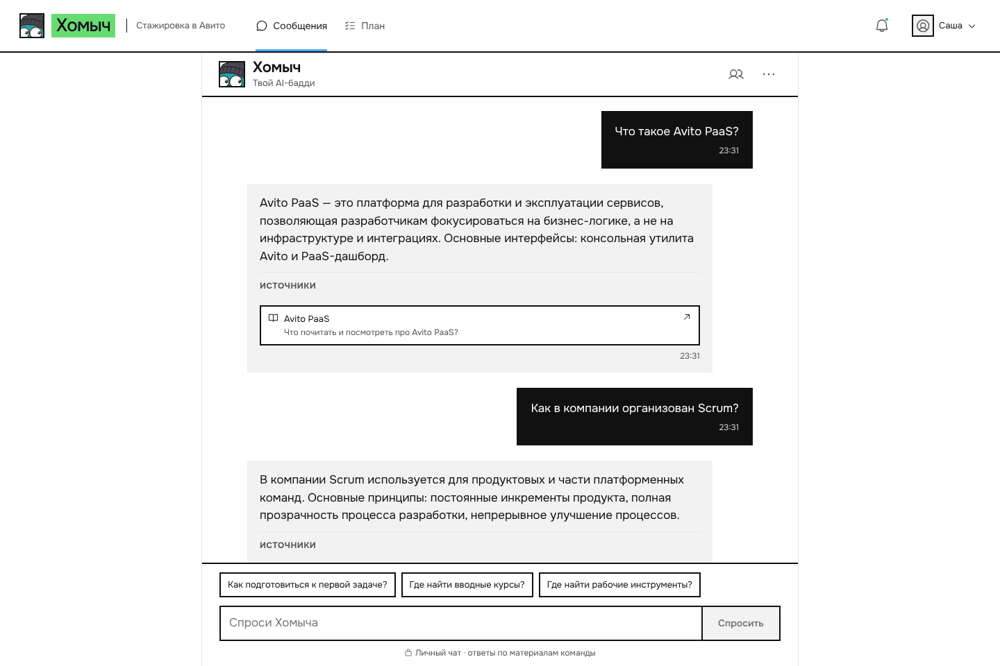
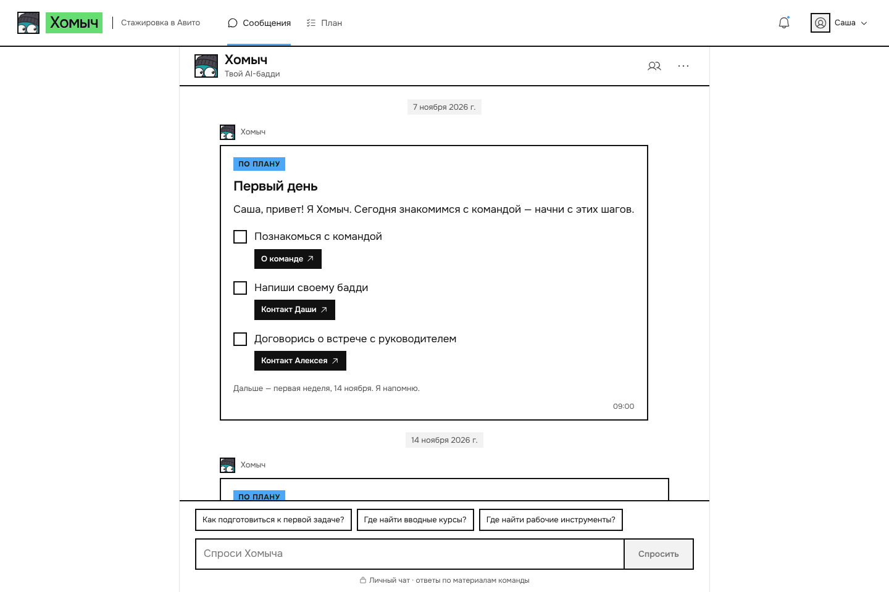
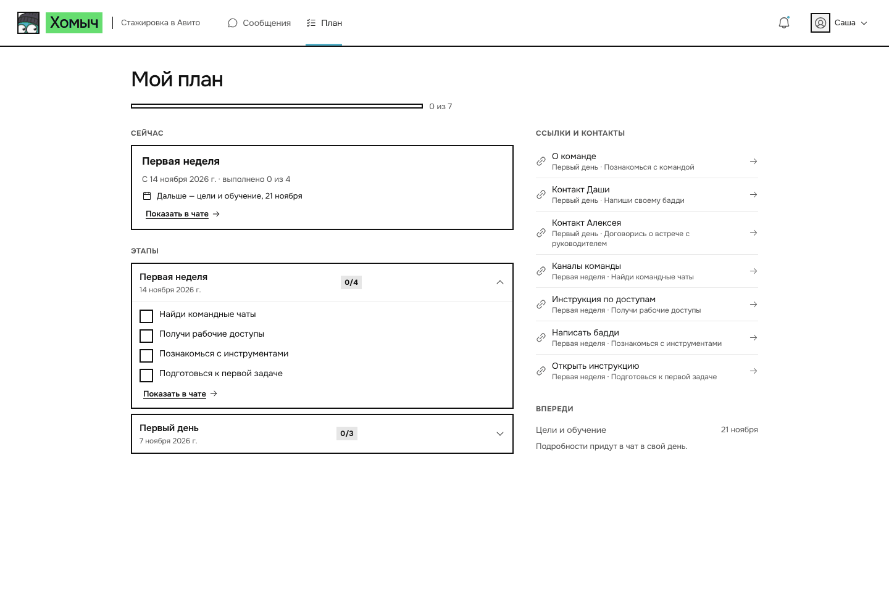
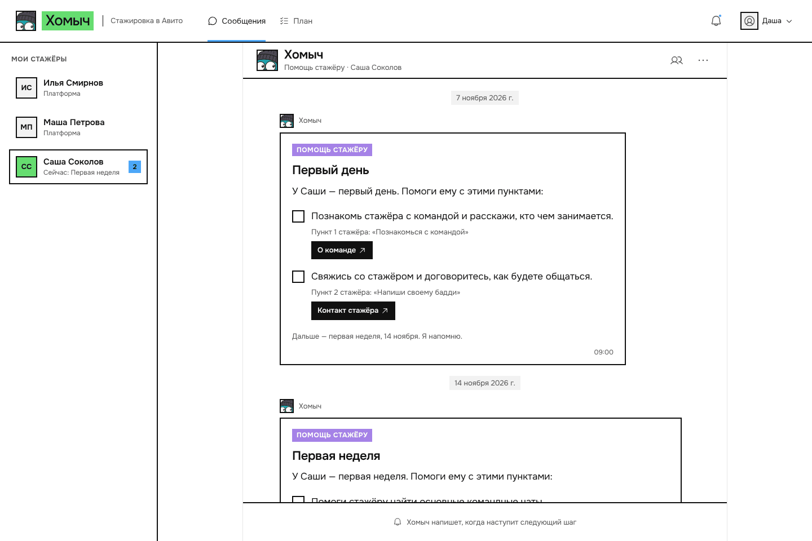
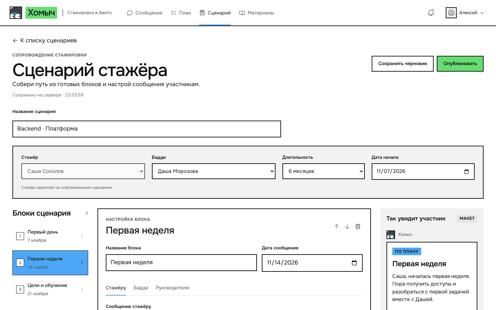
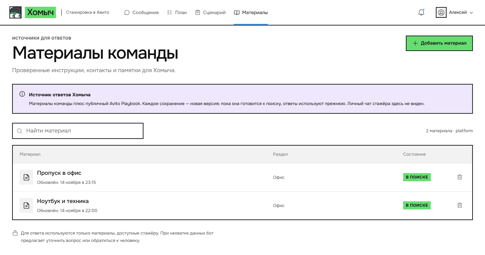
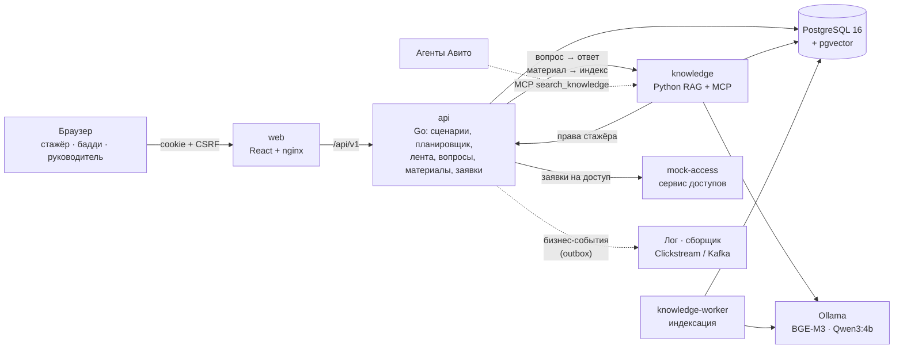

# Хомыч — AI-наставник для стажёров Авито

Команда Origination · Avito Hack&Change 2026 · кейс «AI-buddy»

В первые недели стажёр получает много ссылок, задач и контактов сразу, теряется в них и стесняется лишний раз спросить. Бадди и руководителю приходится помнить, кому и когда помочь.

**Хомыч** ведёт стажёра по плану стажировки: в нужный день присылает сообщение с чек-листом шагов, отвечает на вопросы по материалам команды со ссылками на источники и напоминает бадди и руководителю, чем помочь. Отметки в чек-листах ни на что не влияют: следующий этап всё равно приходит по календарю.



## Для кого

| Роль | Что получает |
|---|---|
| **Стажёр** | Сообщения-чек-листы по датам плана: что сделать, где ссылка, кому написать. Личный чат с Хомычем: ответ по материалам команды и Avito Playbook со ссылками на источники или честное «в материалах этого нет, уточни у бадди». Вкладка «План»: этапы, прогресс и все ссылки в одном месте. |
| **Бадди** | Колонка «Мои стажёры». Те же этапы в формулировке «помоги стажёру» и статусы заявок на доступ. Личный чат стажёра бадди не видит. |
| **Руководитель** | Конструктор сценария стажировки из готовых блоков: тексты и пункты отдельно для стажёра, бадди и себя. Экран «Материалы»: памятки команды, по которым отвечает Хомыч. |

<table>
<tr>
<td width="50%"><br><sub>Этап приходит в свой день, с чек-листом и ссылками</sub></td>
<td width="50%"><br><sub>«План»: этапы, прогресс и все ссылки стажёра</sub></td>
</tr>
<tr>
<td><br><sub>Бадди: свои стажёры и подсказки, чем помочь</sub></td>
<td><br><sub>Руководитель: сценарий из блоков с предпросмотром</sub></td>
</tr>
<tr>
<td><br><sub>Материалы команды: версии и индексация для ответов</sub></td>
<td></td>
</tr>
</table>

## Возможности

- **Сообщения по календарю.** Серверный планировщик рассылает этапы в 09:00 их даты всем трём ролям, даже если никто не открыл приложение. Каждый этап доставляется ровно один раз.
- **Вопросы к AI.** Вопрос сохраняется сразу. Фоновый обработчик спрашивает RAG и повторяет попытку при сбое. Ответ приходит даже после перезагрузки страницы, а если модель недоступна — честное сообщение.
- **Ответы только по разрешённому.** Права проверяются до поиска: материалы одной команды не видны другой. Если данных нет, Хомыч так и говорит и не придумывает.
- **Подсказки вопросов** по текущему этапу.
- **Материалы команды** с версиями. Пока новая версия индексируется, ответы используют прежнюю.
- **Заявка на доступ** через внешний сервис: в демо — мок с подтверждением. Первая задача открывается только после одобрения.
- **Приватность.** Личный чат стажёра не видят ни бадди, ни руководитель.
- **Бизнес-события для аналитики.** Публикация этапа, отметки, вопросы и их исходы, материалы, заявки — 14 событий через outbox: пишутся в той же транзакции, что и изменение, и доставляются с повторами в лог или сборщик (Clickstream, Kafka REST). Без текстов вопросов — [каталог](docs/architecture/events.md).
- **Для агентов Авито.** База знаний доступна по MCP (`search_knowledge`) и HTTP без нашего фронтенда — [подробнее](knowledge/EXTERNAL.md).

## Архитектура



| Компонент | Технологии | Что делает |
|---|---|---|
| [`frontend/`](frontend/README.md) | React, TypeScript, Vite | Интерфейс трёх ролей. Состояние берётся с сервера через общий клиент `api.ts`. |
| [`backend/`](backend/README.md) | Go 1.24 (stdlib `net/http`), PostgreSQL 16 | Модульный монолит: identity, scenarios, messages (планировщик и лента), answers, suggestions, sources, access, demo. Фоновые задания с lease и повторами, идемпотентность, ETag/If-Match, CSRF и Origin, Prometheus-метрики, outbox бизнес-событий. |
| [`knowledge/`](knowledge/README.md) | Python, FastAPI, pgvector, Ollama | Гибридный поиск (векторный и полнотекстовый) с фильтром прав до ранжирования. Ответ Qwen3:4b строго в JSON со ссылками только на выданные фрагменты. Очередь индексации и MCP-сервер. |
| `mock-access` | Go | Замена сервиса доступов Авито для демо: одобрение, отказ, потерянный ответ и сверка по `correlationId`. |

Контракт API — [OpenAPI](docs/architecture/openapi.yaml): 23 операции из контракта и 9 расширений, тест проверяет маршрут каждой. Подробности — в [карте документации](docs/README.md).

## Быстрый старт (без AI)

Нужен [Docker Desktop](https://www.docker.com/products/docker-desktop/). Из корня репозитория:

```sh
docker compose up --build
```

Откройте **http://localhost:8088** и войдите любым тестовым пользователем — пароль не нужен.

| Пользователь | Роль | Команда |
|---|---|---|
| Саша Соколов | стажёр с опубликованным планом | platform |
| Маша Петрова, Илья Смирнов | стажёры (у Маши черновик плана) | platform |
| Даша Морозова | бадди | platform |
| Алексей Романов | руководитель | platform |
| Кирилл Орлов, Олег Кузнецов, Ирина Волкова | стажёр, бадди, руководитель — для проверки изоляции | mobile |
| Анна Петрова | HR | — |

Работает всё, кроме ответов AI: на вопрос Хомыч честно отвечает, что поиск по материалам на этом стенде не подключён, и сохраняет вопрос.

| Сервис | Адрес | Сменить порт |
|---|---|---|
| Приложение | http://localhost:8088 | `HOMYCH_WEB_PORT` |
| API | http://localhost:8080/healthz | `HOMYCH_API_PORT` |
| Мок сервиса доступов | http://localhost:8091 | `HOMYCH_MOCK_PORT` |
| PostgreSQL | localhost:55432 | `HOMYCH_DB_PORT` |

Остановка: `Ctrl+C`, затем `docker compose down`. Данные остаются в volume.

## Запуск с AI

Нужны две модели Ollama: `bge-m3:567m` для поиска (~1,2 ГБ) и `qwen3:4b` для ответов (~2,5 ГБ). Команды вводите **по одной**: zsh на macOS по умолчанию не понимает комментарии `#` в интерактивной строке.

**1. Настройки**

```sh
cp .env.example .env
```

В `.env`:

- `RAG_SERVICE_TOKEN` — любая случайная строка от 24 символов;
- для экрана «Материалы»: выполните `python knowledge/examples/keygen.py`. «Client token» вставьте в `RAG_SOURCES_TOKEN`, «Server token_sha256» — в `RAG_EXTERNAL_CLIENTS` по образцу из `.env.example`.

**2. Модели — один из вариантов**

*Вариант А — Ollama на компьютере.* Рекомендуется на Mac: работает на GPU, ответ за секунды. Установите с [ollama.com](https://ollama.com) или через `brew install ollama` и запустите сервер (если приложение Ollama уже открыто, этот шаг не нужен):

```sh
ollama serve
```

В другом терминале:

```sh
ollama pull bge-m3:567m
```
```sh
ollama pull qwen3:4b
```
```sh
echo 'RAG_OLLAMA_URL=http://host.docker.internal:11434' >> .env
```

Прерванная загрузка продолжается с того же места: повторите `ollama pull`.

*Вариант Б — Ollama в Docker.* В Docker Desktop нужно от 8 ГБ памяти. Модели скачиваются после запуска стенда (шаг 3).

**3. Запуск и индексация Avito Playbook** (индексация — только в первый раз)

```sh
docker compose -f docker-compose.yml -f docker-compose.rag.yml up -d --build --wait
```

Только для варианта Б:

```sh
docker compose -f docker-compose.yml -f docker-compose.rag.yml exec ollama ollama pull bge-m3:567m
```
```sh
docker compose -f docker-compose.yml -f docker-compose.rag.yml exec ollama ollama pull qwen3:4b
```

Для обоих вариантов:

```sh
docker compose -f docker-compose.yml -f docker-compose.rag.yml exec knowledge python -m homych_knowledge.ingest playbook
```
```sh
curl http://localhost:8090/readyz
```

`{"status":"ok"}` означает, что стенд готов. Индексация Playbook заменяет весь корпус, поэтому делайте её до добавления материалов через экран.

**4. Проверка.** Войдите Сашей и спросите:

- «Что такое Avito PaaS?» — ответ со ссылкой на Playbook;
- «Сколько дней отгула мне положено в первый месяц?» — «нет подтверждённого ответа, уточни у бадди».

Если что-то не так:

```sh
docker compose -f docker-compose.yml -f docker-compose.rag.yml logs --tail 50 api knowledge knowledge-worker
```

Строки `answer request=…` в логе `knowledge` показывают, что нашёл поиск и что решила модель. Текст вопросов в лог не пишется.

На CPU ответ занимает до минуты: Хомыч показывает «Ищу в материалах команды», ответ сохраняется на сервере и приходит, даже если закрыть вкладку. Остановка: `docker compose -f docker-compose.yml -f docker-compose.rag.yml down` — данные и модели остаются в volumes. Без модели (для проверки) можно указать `RAG_PROVIDER=deterministic` в `.env` и повторить индексацию; такие ответы помечены как тестовые.

## Как показать демо (5 минут)

1. Профиль → «Демо-стенд» → **«Начать демо заново»**.
2. **Саша:** лента этапов с чек-листами, вкладка «План». Вопрос Хомычу — ответ со ссылкой на источник. «Инструкция по доступам» → заявка → через 20 секунд «Доступ одобрен», первая задача открылась.
3. **Даша:** колонка «Мои стажёры», те же этапы в формулировке «помоги стажёру», статус заявки Саши. Личного чата Саши не видно.
4. **Алексей:** «Сценарий» — создать и опубликовать. «Материалы» — добавить памятку, через несколько секунд статус «В поиске», и Саша получает ответ по ней. Кирилл из другой команды по этой памятке ответа не получит.
5. «Демо-стенд» → дата на неделю вперёд: всем трём ролям приходит новый этап и уведомление в колокольчике, подсказки вопросов меняются.

## Структура репозитория

```text
├── backend/          Go API, миграции, мок сервиса доступов
├── frontend/         React-приложение, nginx-образ, дизайн-материалы
├── knowledge/        Python RAG, MCP-сервер, индексация, оценка качества
├── docs/             документация: продукт, архитектура, процессы, отчёты — см. docs/README.md
├── output/           собранные документы для жюри: Word, PDF, модели BPMN
├── tools/            скрипты сборки документации и проверка структуры для CI
├── docker-compose.yml            стенд без AI
├── docker-compose.rag.yml        добавка: RAG, индексация, Ollama
└── docker-compose.knowledge.yml  отдельный сервер знаний для внешних агентов
```

## Разработка и проверки

```sh
cd backend && make db && make test && make cover
```
```sh
cd frontend && npm ci && npm run check && npm test && npm run build
```
```sh
cd knowledge && uv sync --frozen && uv run ruff check . && uv run pytest
```

| Часть | Что проверяется | Состояние на 14.11 |
|---|---|---|
| Go | тесты на PostgreSQL с `-race`, тест маршрутов по OpenAPI | покрытие 89 % |
| Python RAG | ruff, тесты с pgvector | покрытие 83 % |
| Frontend | типы, юнит-тесты, сборка | 57 тестов |
| Документация | `python tools/verify_team_handoff.py` | связи требований, функций, API и BPMN |

CI — `.github/workflows/`: `backend.yml`, `frontend.yml`, `knowledge.yml` (включая проверку Compose). Новый серверный модуль добавляется в `backend/internal/<модуль>/` по образцу существующих — см. [backend/README.md](backend/README.md).

## Статус и ограничения

Из 47 продуктовых требований 39 реализованы, 5 частично, 3 не реализованы: это неутверждённые предложения про HR. Все 23 операции контракта API реализованы. Подробно — [аудит реализации на 14 ноября](docs/reports/implementation-audit-2026-11-14.md).

В продукте Авито заменяется: демо-вход — на SSO, мок — на сервис доступов Авито, веб-уведомления — на пуш или мессенджер, публичный Avito Playbook — на внутреннюю базу знаний. Контакты и тексты сценариев условные. Бизнес-события уходят в лог или HTTP-сборщик; адаптер Kafka — следующий шаг. Ещё не сделаны: экран метрик пользы, фича-флаги, переназначение бадди через интерфейс.

## Документация

- [Карта документации](docs/README.md) — с чего начать и где что лежит.
- [Спецификация продукта](docs/product/team-specification.md), [47 требований](docs/product/functional-requirements.md), [Q&A с Авито](docs/product/avito-qa.md).
- [OpenAPI](docs/architecture/openapi.yaml), [бизнес-события](docs/architecture/events.md), [RAG и MCP](docs/architecture/ai-rag-mcp.md), [BPMN P00–P17](docs/processes/bpmn-v3/README.md).
- [Полная спецификация в Word](output/ai-buddy-team-specification.docx).
