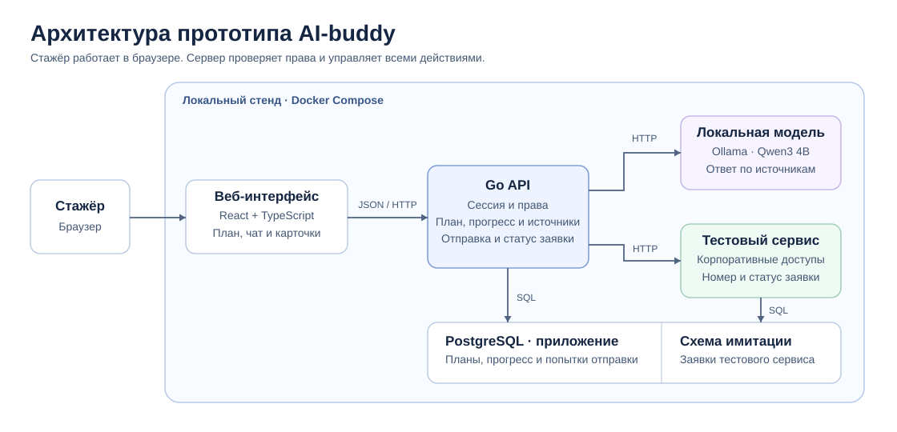
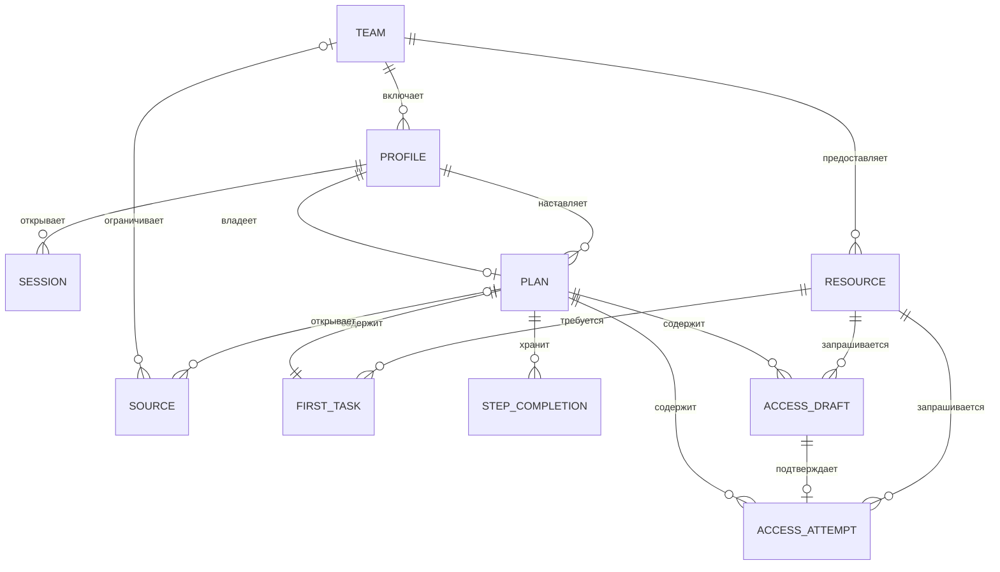
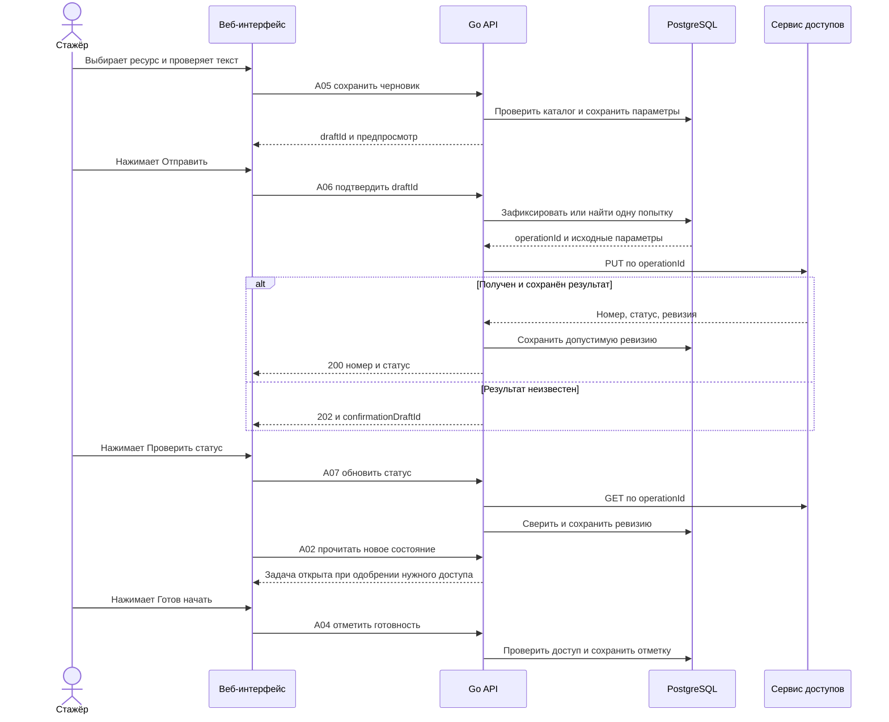

# Системная спецификация AI-buddy

**Историческая редакция.** Для новой разработки использовать [team-specification.md](team-specification.md) и [server-handoff.md](server-handoff.md). Старый OpenAPI сохранён отдельно; текущий контракт — проект 23 операций. OQ01 закрыт, чек-листы не блокируют календарь.

**Предыдущая граница прототипа.** После уточнений от 11 ноября 2026 года актуальны [требования 0.2](functional-requirements.md) и [BPMN версии 3](bpmn-v3/README.md). Ниже сохранены технические решения прежнего MVP. Контракты и экраны ещё требуют согласования с новой концепцией; прямая интеграция доступов условна по OQ08.

Версия спецификации 1.0 · 10 ноября 2026 года.

Прототип начинается с готового опубликованного плана. Стажёр входит, знакомится с командой, подтверждает заявку на нужный доступ и после одобрения отмечает готовность к первой задаче. Модель помогает найти информацию и составить черновик. Go API проверяет права и выполняет изменения по команде стажёра. Тестовый сервис выдаёт номер и статус заявки.

| Материал | Назначение |
|---|---|
| [Границы и роли по 40 шагам](system-analysis/process-scope.md) | Связь актуального листа 3 с BPMN, владельцами действий и объёмом автоматизации. |
| [Контракт OpenAPI](system-analysis/openapi.yaml) | Форматы запросов и ответов фронтенда и Go API, перечисления, коды и примеры. |
| [Приёмка и задания](handoff.md) | Матрица P00–P14, порядок разработки и проверяемые сценарии. |
| [Контекст продукта](product-context.md) и [каталог BPMN](bpmn-v2/README.md) | Путь стажировки и исходные решения. |

Снимок A1:F41 сверён с [третьим листом «Чек-лист по ролям»](https://docs.google.com/spreadsheets/d/1NWVMqilKgqZi8yAycCZPl8OPpLT64qWxFunl_TIbkYc/edit#gid=1846725631). P02–P07 и P14 описывают интерфейс стажёра и поддерживающие операции. P00, P01, P08–P13 дают границы полной версии. Шаги бадди, руководителя и HR вне интерфейса служат входами и выходами бизнес-процессов. Настройку и публикацию заменяют тестовые данные с планами на 6 и 9 месяцев. При внедрении источники HR, правила доступа и владельцев решений согласуют с Авито.

## Архитектура

| Компонент | Ответственность |
|---|---|
| **React + TypeScript** | Экраны S0–S4, ввод, предпросмотр и явное подтверждение. Использует состояние из API. Показывает ожидание внутри карточки, пока остальные действия доступны. |
| **Go API** | Сессия, права, разрешённые источники, выбор следующего шага. Владеет прогрессом и жизненным циклом попытки. Вызывает модель и сервис через отдельные адаптеры. |
| **PostgreSQL** | Состояние приложения в схеме `app`. Имитация сервиса хранит заявки в `access_mock`. Раздельные учётные записи БД. Каждый компонент пишет только в свою схему. |
| **Адаптер модели** | Режим `demo` выдаёт воспроизводимые ответы по синтетическим материалам. Режим `ollama` использует локальную модель `qwen3:4b` через тот же контракт. |
| **HTTP-имитация доступов** | Владеет номером и статусом заявки. Принимает один результат на ID операции и позволяет прочитать его. |

Один origin для веб-интерфейса и API. Docker Compose запускает UI, API, БД и имитацию. Модель, БД и имитация доступны API по внутренней сети. Режим `demo` работает без внешнего ключа и скачивания модели после подготовки контейнеров. Для живого режима оператор поднимает Ollama и заранее загружает модель. При пилоте демо-сессию заменяет корпоративная авторизация, синтетические материалы — разрешённые источники, а имитацию — адаптер согласованного корпоративного сервиса.

## Правила и состояния

| ID | Инвариант |
|---|---|
| **R01** | План доступен по сессии владельца. Если опубликованного плана нет, S0 показывает контакт руководителя из своего профиля. |
| **R02** | Стажёр может открыть любую из трёх карточек. Рекомендация помогает выбрать шаг, а завершение знакомства не требуется для подачи заявки. |
| **R03** | Знакомство и готовность подтверждает стажёр. Повторная отметка возвращает исходное время завершения. Шаг «Доступы» считается выполненным по одобрению нужного ресурса. |
| **R04** | Первая задача доступна только при сохранённом `approved` для ресурса, указанного в этой задаче. До этого S4 возвращает блокер и разрешённый переход в «Доступы». Текст, критерии, материалы и их выдержки закрыты также для чата. |
| **R05** | Черновик неизменяем. Изменение текста даёт новый `draftId`. Отправка требует явного подтверждения конкретного предпросмотра. |
| **R06** | Для пары план и ресурс существует одна попытка. Её ID операции и подтверждённые параметры сохраняются до внешнего вызова и неизменны при повторе. |
| **R07** | Состояние заявки определяется последним допустимым ответом сервиса. Ответ с меньшей ревизией игнорируется. Равная ревизия должна содержать тот же результат. Терминальный статус в демо не меняется. |
| **R08** | Ответ AI даёт справку, ссылки и предложение перехода. Сервер проверяет ссылки и ресурсы. Открытие карточки, отметка прогресса, подтверждение заявки и проверка статуса — отдельные действия стажёра. |

### Заявка и следующая подсказка

| Состояние | Условие и следующий переход | Что видит стажёр |
|---|---|---|
| `not_requested` | Попытки нет. Наличие черновика состояние не меняет. Подтверждение и фиксация попытки переводят в `submitting`. | «Подготовить заявку» или сохранённый в текущей форме предпросмотр. |
| `submitting` | Попытка есть, подтверждённый результат сервиса не сохранён. Повтор отправляет тот же `operationId`. Явная проверка может восстановить уже созданную заявку. | «Результат отправки пока неизвестен», «Повторить» с исходным `confirmationDraftId`, возможность заняться другими шагами. |
| `pending` | Сервис вернул номер и состояние согласования. Явная проверка читает актуальную ревизию. | Номер, «На согласовании», кнопка «Проверить статус». |
| `approved` | Сервис подтвердил одобрение. Открывает S4 только для требуемого ресурса. | Номер и «Одобрена». Если это нужный ресурс, появляется постановка. |
| `denied` | Сервис вернул отказ. Для той же пары план и ресурс повторного создания в демо нет. | Номер, «Отклонена», причина при наличии и контакт бадди. |

`submitting` может перейти сразу в любой подтверждённый сервисом статус. `pending` остаётся `pending` или переходит в `approved` / `denied`. Потеря ответа не означает отказа. Если проверка не удалась, прежний статус сохраняется и интерфейс показывает, что обновление недоступно.

Следующий шаг вычисляет API по порядку: если знакомство открыто, рекомендует `team_intro`. Иначе, если нужный доступ не одобрен, рекомендует `request_access`, `retry_access`, `check_access` или `contact_buddy` по его состоянию. После одобрения рекомендует `first_task_ready`, пока стажёр не отметил готовность. После трёх стартовых шагов предлагает `view_milestone`. Состояние каждой карточки доступно отдельно от рекомендации.

## Данные и доступ

| Сущность | Ключи, связи и источник данных | Доступ в MVP |
|---|---|---|
| **Team, Profile** | Синтетические команды и профили. Профиль содержит роль, `teamId`, имя, контакт руководителя и демо-учётные данные. В плане назначен бадди. | Стажёр видит свой профиль и разрешённую часть карточки своей команды. Пароль в API не возвращается. Запись через загрузку демо-данных. |
| **Session** | Случайный токен и срок действия, связь с профилем. Сервер сохраняет хеш токена. | По cookie. Новый успешный вход меняет токен. Демо-сессия действует 8 часов, без продления. |
| **Plan, FirstTask** | У стажёра максимум один опубликованный план. Хранит дату, длительность 6/9, бадди, этап и следующую точку. Задача связана с планом и одним ресурсом своей команды. | Владелец читает план. Закрытую часть задачи и источники читает после R04. Запись через загрузку демо-данных. |
| **Source** | ID, название, проверенный текст, необязательная HTTPS-ссылка, область `common`, `team` или `task`. Для `team` обязателен `teamId`, для `task` — ID плана. | Общие материалы, материалы своей команды и разрешённые материалы своей задачи. Отбор один и тот же для API и входа модели. |
| **Resource** | ID и имя. Ресурс принадлежит команде. Нужный для задачи ресурс указан в `FirstTask`. | Только каталог своей команды. Запись через демо-данные. |
| **StepCompletion** | Уникально по `planId + stepKey`. Сохраняется первое `completedAt`. Разрешены `team_intro` и `first_task_ready`. | Владелец пишет явным действием. Для `first_task_ready` сервер заново проверяет R04 внутри операции сохранения. |
| **AccessDraft** | Серверный ID, план, ресурс, нормализованное обоснование, время. Создаётся новый при изменении текста. | Свой план и разрешённый ресурс. Открытая форма может отменить действие без отправки. |
| **AccessAttempt** | Уникальность `planId + resourceId` и `operationId`. Фиксирует исходный черновик и параметры. Номер, статус, ревизия и причина появляются после ответа сервиса. | Свой результат. Сервер создаёт по подтверждению и обновляет по ответу имитации. |
| **MockRequest** | `operationId` — первичный ключ. Параметры запроса, уникальный номер, статус, возрастающая ревизия, доступная причина. | Только внутренний HTTP-адаптер Go API. Имитатор ведёт собственную запись. |

Привязки ресурса к команде, попытки к черновику и прогресса к плану проверяются сервером. Для схемы БД предусмотреть внешние ключи и уникальные ограничения. Состояние S1 рассчитывается из плана, отметок и подтверждённых результатов. Повторный вход читает то же состояние. Демо-данные и миграции должны повторно запускаться без создания дубликатов.

Все закрытые маршруты проверяют сессию и роль стажёра до поиска объекта. Владелец определяется только по сессии. Отсутствующий и чужой объект дают одинаковый `404 not_found`. Для собственного отсутствующего опубликованного плана код `plan_unavailable` возвращает контакт руководителя из профиля. HR, бадди и руководитель представлены в демо контактами. Права на будущие рабочие интерфейсы даны в карте границ.

Cookie `sid` имеет `HttpOnly`, `SameSite=Lax` и `Path=/api/v1`. При HTTPS добавляется `Secure`. Сборка с HTTP и тестовыми учётными данными предназначена для loopback. Все POST/PUT, включая вход, проверяют точное совпадение Origin с настроенным origin интерфейса. Ответы с пользовательскими данными идут с `Cache-Control: no-store`. Чат и обоснования не пишутся в диагностические логи.

| Роль | Полномочия в целевом процессе |
|---|---|
| **Стажёр** | Читает свой опубликованный план, подтверждает собственные действия, сообщает о прогрессе. |
| **Руководитель** | Ведёт планы закреплённых за ним стажёров, назначает бадди, утверждает постановку, цели и итог. |
| **Бадди** | Готовит материалы для своего стажёра и помогает по задачам. Получает данные, нужные для этой поддержки. |
| **HR** | Ведёт организационные сведения и кадровый процесс. Передаёт приложению только нужные даты, контакты и утверждённый статус. |
| **AI-buddy** | Получает минимальный разрешённый контекст от сервера. Возвращает справку или черновик. |

В прототипе запись через интерфейс доступна только стажёру. Полномочия сотрудников выше описывают границы будущих операций. Точные поля, назначение ролей и правила межкомандного доступа относятся к проектированию полной версии.

## Контракты экрана и сервера

Точные JSON-схемы и примеры находятся в [OpenAPI](system-analysis/openapi.yaml). Публичный префикс — `/api/v1`. Ошибка возвращает `code` и `message`. JSON с ошибкой синтаксиса даёт `400 malformed_json`, корректный JSON с недопустимыми полями — `422 invalid_input`. Неверный Origin даёт `403 origin_mismatch`, неподходящая роль — `403 forbidden_role`. Отсутствующая или истекшая сессия даёт `401 session_required`, интерфейс возвращает на S0.

| ID и операция | Экран и результат |
|---|---|
| **A01** `POST /demo/session` | S0. Вход по `login` и `password`. При успехе профиль и Set-Cookie, при ошибке `401 invalid_credentials`. |
| **A02** `GET /onboarding` | S1–S4. Свой план, команда, две отметки, каталог со статусами, закрытая либо открытая задача и рекомендация. Читает сохранённое состояние без вызова модели или имитации. |
| **A03** `POST /chat` | S1. Вопрос и необязательный контекст карточки. Ответ и разрешённые выдержки, опционально переход и редактируемое предложение обоснования. При сбое модели или отсутствии источника — ответ с `kind: fallback`, без источников и предложенного ресурса. |
| **A04** `PUT /steps/{stepKey}/completion` | S2 и S4. По явной отметке возвращает первое время завершения и пересчитанный следующий шаг. Преждевременная готовность даёт `409 access_required`. |
| **A05** `POST /access-drafts` | S3. Сохраняет разрешённый ресурс и проверенное обоснование, возвращает неизменяемый предпросмотр. Если ресурс уже имеет попытку, `409 attempt_exists` и её состояние. |
| **A06** `POST /access-drafts/{draftId}/confirm` | S3. `action: submit` подтверждает, `action: retry` повторяет подтверждённую операцию по исходному черновику. `200` — номер и статус сохранены. `202` — попытка есть, результат пока неизвестен. `503` до фиксации — этот вызов не отправлял заявку. |
| **A07** `GET /access-requests/{resourceId}` | S3. Явная проверка состояния. `serviceAvailable` равен `null`, если попытки нет и сервис не вызывался, `true` при допустимом ответе, `false` при сбое чтения. При сбое возвращается сохранённое состояние. |

S1 обновляется через A02 после A04, A06 или A07. Локальная кнопка блокируется на время своего запроса, остальные карточки и навигация работают. После сетевой ошибки при подтверждении UI читает сохранённое состояние через A02 перед повтором. Если попытка есть, использует `confirmationDraftId`. Если попытки нет, предлагает подтвердить тот же предпросмотр. Серверная уникальность защищает и при нескольких вкладках.

## Заявка и открытие первой задачи P04–P07

1. **P04.** Сервер проверяет ресурс до выдачи названия и данных. До подтверждения создаётся только черновик в `app`. Предложение AI — обычный текст. При правке форма запрашивает новый черновик. Повторное открытие карточки с попыткой показывает её сохранённое состояние.
2. **P05.** В одной транзакции сервер проверяет принадлежность черновика и ресурса, создаёт или читает попытку по уникальной паре и фиксирует транзакцию. Внешний HTTP вызывается только после успешной фиксации. Для известного результата возвращается существующий снимок без внешнего вызова. Конкурирующий `submit` по другому черновику возвращает каноническую попытку со старым исходным черновиком. `retry` без попытки или по другому черновику даёт `409 retry_not_available`.
3. **P05 при сбое.** Если попытку до вызова зафиксировать не удалось, ответ `503 unavailable`. Если сервис не ответил или ответ не удалось сохранить, API возвращает `202` с уже зафиксированным ID черновика, если подтверждённый снимок отсутствует. Перед возвратом читает свежий снимок, если БД доступна. Если параллельный запрос уже сохранил результат, ответ `200`. Повтор всегда использует прежний `operationId` и прежние параметры.
4. **P06.** A07 может восстановить результат даже после потерянного ответа. При `404` от внутреннего сервиса сохраняется состояние и возвращается `serviceAvailable: false`. Для `submitting` остаётся кнопка повтора. Первый допустимый ответ фиксирует номер. Дальнейшие ответы должны содержать те же ID операции и номер. Сервер атомарно сравнивает ревизию с последней сохранённой версией. Меньшая ревизия и совпадающая равная оставляют снимок без изменения. Конфликт равной ревизии, недопустимый переход или иной невалидный ответ считаются сбоем обновления.
5. **P07.** A02 возвращает закрытую карточку с `requiredResourceId` и разрешённым переходом или открытую с постановкой, критериями и выдержками материалов. При A04 право проверяется повторно. Отказ и одобрение другого ресурса не открывают постановку. Контакт бадди доступен в обоих состояниях.

### Внутренний HTTP адаптер доступов

`PUT /requests/{operationId}` получает `profileId`, `resourceId` и `reason` из неизменяемой попытки. Первый вызов записывает заявку и возвращает `200`. Повтор с тем же ID и параметрами возвращает тот же номер и текущее состояние, даже если результат первого ответа не дошёл. Тот же ID с другими параметрами даёт `409` без изменения заявки. `GET /requests/{operationId}` возвращает `200` либо `404` для неизвестной операции. Ответ `200` содержит `operationId`, `requestNumber`, `status` из `pending | approved | denied`, целую положительную `revision` и необязательную `denialReason` только при отказе. При конфликте или невалидном ответе приложение сохраняет последнюю подтверждённую версию и фиксирует техническое событие.

У имитации есть воспроизводимые исходы `approve` и `deny` из тестовых данных. Обычный сценарий создаёт `pending` с ревизией 1, после заданной задержки чтение показывает выбранный терминальный статус с ревизией 2. Тесты управляют временем и сбоями через тестовый адаптер или запуск имитации с отдельной конфигурацией. Пользовательский API не управляет исходом заявки.

## Остальные взаимодействия P02 P03 P14

| Процесс | Вызовы, запись и исключения |
|---|---|
| **P02 Вход** | S0 вызывает A01. API создаёт сессию и возвращает профиль, UI затем вызывает A02. При `401` остаётся экран входа, при `plan_unavailable` показывается контакт руководителя, при временном сбое A02 доступен повтор чтения. |
| **P03 Команда** | S2 читает команду из A02. «Отметить знакомство» вызывает A04, API записывает первую отметку. «Контакт бадди» и «Отложить» используют уже показанные данные и не пишут прогресс. |
| **P14 Чат** | A03 определяет план и доступные источники, выбирает подходящие выдержки, вызывает адаптер и проверяет ответ. UI показывает проверенный текст, раскрываемые выдержки и разрешённое действие. При отсутствии источника, тайм-ауте или некорректном ответе доступно уточнение или контакт бадди. |

Сервер сначала отбирает материалы по правам и R04, затем ищет совпадения с вопросом в этой выборке. Деморежим использует те же правила отбора и воспроизводимые ответы. Адаптер модели получает вопрос, ключ карточки, список разрешённых ресурсов и выбранные выдержки с ID. Возвращает `reply`, `sourceIds` и необязательную пару `suggestedResourceId` / `suggestedReason`. Сервер проверяет, что каждый ID источника входит в переданный список, а ресурс входит в текущий каталог и предложение содержит обоснование. Выдержки и ссылки берутся из проверенных записей источника. Нет подходящих разрешённых источников — модель не вызывается. Ответ отображается как текст. Переход собирается сервером из разрешённого списка карточек. Предложение ресурса заполняет форму, отправка происходит по A06. Адаптер модели не имеет доступа к операциям API.

## Проверяемые требования и запуск

- **N01 Изоляция.** Два тестовых аккаунта из разных команд. У них разные планы, задачи, источники и ресурсы. Прямые запросы с чужими ID дают `404`. Скрытая постановка отсутствует в ответе A02 и в контексте A03.
- **N02 Восстановление.** После перезапуска с сохранённым томом PostgreSQL восстанавливаются отметки, номер, статус и возможность повтора. Повторы и конкуренция дают одну заявку по паре план и ресурс.
- **N03 Отклик.** Ориентир из кейса — простые действия без внешнего ожидания занимают менее 1 секунды. На проверке измеряются открытие карточки, показ формы и сохранение локальной отметки. Ожидание модели и имитации отображается в активном действии. Дедлайны адаптеров для MVP — 10 секунд на модель и 3 секунды на сервис доступов.
- **N04 Чистый запуск.** `docker compose up --build` после получения базовых образов поднимает демо на `http://localhost:8080`. README приложения содержит версии, тестовые учётные данные, команды миграции/seed, тестов и сброса демо, основной маршрут и способ проверить отказ, потерю ответа и тайм-аут. Локальный режим модели проверяется отдельным прогоном.
- **N05 Покрытие.** Строго больше 80% строк прикладного кода, включая собственный тестовый сервис. В отчёте указаны включённые пути и команда воспроизведения. Исключены тесты, зависимости и сгенерированный код. Для объединения отчётов использовать покрытые и измеряемые строки по файлам, без среднего от процентов. Go-профиль по операторам отдельно от итогового показателя покрытия строк.
- **N06 Диагностика.** Структурированные события с идентификатором запроса, операцией, кодом, задержкой и признаком повтора. Фиксируются вызов, тайм-аут, некорректная ревизия и отказ доступа. Секреты, обоснования и тексты источников в события не попадают.

Форматы, коды и численные дедлайны выше — решения спецификации MVP. Реальные политики авторизации, хранение кадровых данных, согласование доступа и правила публикации плана уточняются с владельцами сервисов перед пилотом. Контракты приложения описаны по [OpenAPI 3.1](https://spec.openapis.org/oas/v3.1.0.html).
